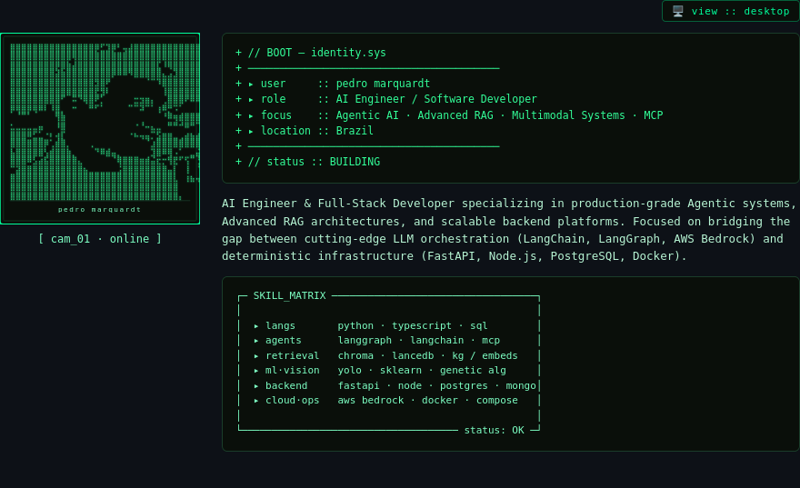

<!--
  profile :: Pedro-Marquardt
  theme   :: terminal / cyberpunk · dark-mode first
  layout  :: HTML heroes → PNG · <picture> desktop ↔ mobile
-->

<!-- Viewport-aware hero: side-by-side on desktop, stacked on mobile -->
<p align="center">
  <picture>
    <source media="(max-width: 768px)" srcset="./hero-mobile.png" />
    
  </picture>
</p>

<p>
  <a href="https://www.linkedin.com/in/pedro-rufino-marquardt-3030ba189"></a>
  <a href="https://github.com/Pedro-Marquardt"></a>
</p>

<p>


</p>

---

### `// featured_projects`

| # | Project | Description | Stack |
|:--|:--------|:------------|:------|
| `01` | [**medical-assistant**](https://github.com/Pedro-Marquardt/medical-assistant) | Clinical assistant powered by RAG + MCP with fine-tuned LoRA (Mistral 7B). | `FastAPI` · `LangGraph` · `ChromaDB` |
| `02` | [**women-health**](https://github.com/Pedro-Marquardt/women-health) | Multimodal AI platform for women's healthcare support & clinical analysis. | `Streamlit` · `YOLOv8` · `Multimodal LLM` |
| `03` | [**ml-diabetes-detection**](https://github.com/Pedro-Marquardt/ml-diabetes-detection) | Predictive ML model for diabetes screening paired with LLM-generated diagnostic insights. | `FastAPI` · `Scikit-Learn` · `LLM Integration` |
| `04` | [**talent-acquisition-ai**](https://github.com/Pedro-Marquardt/talent-acquisition-ai) | AI-driven HR pipeline featuring automated OCR parsing & candidate evaluation. | `FastAPI` · `MongoDB` · `Tesseract` |

```text
// PRIVATE LAYER :: Enterprise Customer Service Agents · ESG Knowledge Graphs (Vector + SQL) · Healthcare MCP Pipelines
```

---

### `// now`

```diff
+ // NOW
+ ▸ building  :: agent systems · RAG pipelines · health / compliance tools
+ ▸ stack     :: python · typescript · langgraph · chroma · docker · bedrock
+ ▸ open_to   :: collaborations · hard AI product problems
```

---

### `// connect`

```text
linkedin :: https://www.linkedin.com/in/pedro-rufino-marquardt-3030ba189
github   :: https://github.com/Pedro-Marquardt
signal   :: ping welcome — builders only
```

<p>
  <a href="https://www.linkedin.com/in/pedro-rufino-marquardt-3030ba189"></a>
  <a href="https://github.com/Pedro-Marquardt"></a>
</p>

---

<p align="center">
  <code>eof :: profile.readme — responsive · dark mode preferred</code>
</p>
