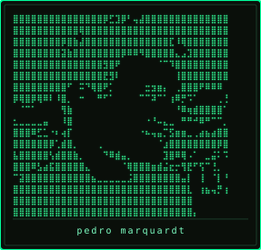

<!--
  profile :: Pedro-Marquardt
  theme   :: terminal / cyberpunk · dark-mode first
-->

<table>
<tr>
<td valign="top" width="34%" align="center">



<br/>

`[ cam_01 · online ]`

</td>
<td valign="top" width="66%">

```diff
+ // BOOT — identity.sys
+ ────────────────────────────────────────
+ ▸ user   :: pedro marquardt
+ ▸ role   :: ai engineer / agent builder
+ ▸ focus  :: rag · agents · health · compliance
+ ▸ loc    :: brazil
+ ────────────────────────────────────────
+ // status :: BUILDING
```

Sistemas de IA orientados a produto — roteamento semântico, fine-tuning, pipelines multimodais e tooling para vector DBs.

<p>
  <a href="https://www.linkedin.com/in/pedro-rufino-marquardt-3030ba189"></a>
  <a href="https://github.com/Pedro-Marquardt"></a>
</p>

```text
┌─ SKILL_MATRIX ──────────────────────────────────┐
│                                                 │
│  ▸ langs       python · typescript · sql        │
│  ▸ agents      langgraph · langchain · mcp      │
│  ▸ retrieval   chroma · lancedb · kg / embeds   │
│  ▸ ml·vision   yolo · sklearn · genetic alg     │
│  ▸ backend     fastapi · node · postgres · mongo│
│  ▸ ops         docker · compose · n8n           │
│                                                 │
└──────────────────────────────────── status: OK ─┘
```

<p>


</p>

</td>
</tr>
</table>

---

### `// featured_projects`

```diff
+ [01] chroma-admin-cli
+ ▸ desc  :: TUI interativa para admin / explore de ChromaDB
+ ▸ stack :: python
+ ▸ href  :: https://github.com/Pedro-Marquardt/chroma-admin-cli

+ [02] medical-assistant
+ ▸ desc  :: assistente médico · RAG + MCP · LoRA (Mistral 7B)
+ ▸ stack :: fastapi · langgraph · chroma
+ ▸ href  :: https://github.com/Pedro-Marquardt/medical-assistant

+ [03] ArchGuard-AI
+ ▸ desc  :: STRIDE multi-agente a partir de diagramas
+ ▸ stack :: langchain · multi-llm
+ ▸ href  :: https://github.com/Pedro-Marquardt/ArchGuard-AI

+ [04] women-health
+ ▸ desc  :: IA multimodal · suporte clínico · saúde da mulher
+ ▸ stack :: streamlit · yolov8
+ ▸ href  :: https://github.com/Pedro-Marquardt/women-health

+ [05] ml-diabetes-detection
+ ▸ desc  :: predição de diabetes + relatório diagnóstico via LLM
+ ▸ stack :: fastapi · ml
+ ▸ href  :: https://github.com/Pedro-Marquardt/ml-diabetes-detection

+ [06] talent-acquisition-ai
+ ▸ desc  :: talent acquisition · OCR + análise por LLM
+ ▸ stack :: fastapi · mongodb · tesseract
+ ▸ href  :: https://github.com/Pedro-Marquardt/talent-acquisition-ai
```

```text
also  :: customer-service agents · ESG (kg + vector + sql) · health knowledge/mcp
layer :: private
```

---

### `// now`

```diff
+ // NOW
+ ▸ building  :: agent systems · rag pipelines · health / compliance tools
+ ▸ stack     :: python · typescript · langgraph · chroma · docker
+ ▸ open_to   :: collabs · hard AI product problems
```

---

### `// connect`

```text
linkedin :: https://www.linkedin.com/in/pedro-rufino-marquardt-3030ba189
github   :: https://github.com/Pedro-Marquardt
signal   :: ping welcome — builders only
```

<p>
  <a href="https://www.linkedin.com/in/pedro-rufino-marquardt-3030ba189"></a>
  <a href="https://github.com/Pedro-Marquardt"></a>
</p>

---

<p align="center">
  <code>eof :: profile.readme — dark mode preferred</code>
</p>
